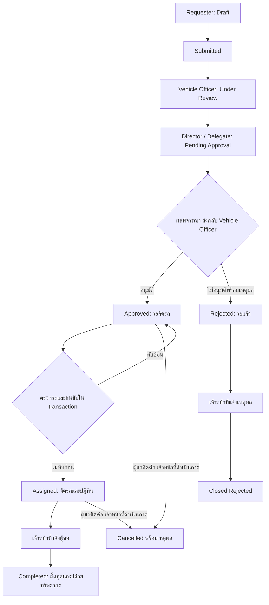
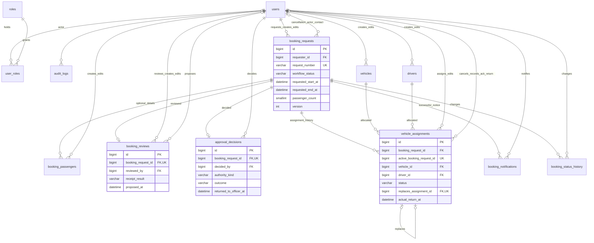

# Task 02 Revision — UP Van Booking ตามรายการข้อมูลแบบฟอร์ม

สถานะ: candidate design ก่อน Task 03 ไม่ได้เชื่อม MySQL หรือรัน migration ไม่มี Login/SSO/บัญชีจริง/booking endpoint ใหม่

## อัปเดต Task 03 Phase A

Candidate 002 แก้ expense enum เป็น driver_extra_pay ให้ตรง “เงินเพิ่มพิเศษพนักงานขับรถ” แล้ว, ใช้ utf8mb4_unicode_ci, FK default restrictive behavior และ SQL SECURITY INVOKER view ไม่เปลี่ยน workflow/RBAC และยังไม่รัน migration ดู docs/task03-preflight.md / docs/task03-database-setup.md ข้อความด้านล่างที่กล่าวถึง enum เก่าเป็นประวัติตอนรับภาพ ไม่ใช่ค่าที่ให้ใช้ปัจจุบัน

## อัปเดตหลังได้รับภาพต้นฉบับ

ได้รับภาพต้นฉบับในงาน UI prototype ถัดมาแล้ว สำเนาอยู่ docs/reference/original-form.png และรายละเอียดถอดแบบอยู่ [UI Specification](form-ui-specification.md) ช่องค่าใช้จ่ายสุดท้ายในภาพคือ “เงินเพิ่มพิเศษพนักงานขับรถ” ต่างจาก enum driver_personal_funds ของ candidate เดิม UI ใช้ driver_extra_pay เพื่อไม่เปลี่ยนข้อความต้นฉบับ แต่ยังไม่แก้ migration ในงาน UI นี้ ห้ามนำค่าทั้งสองมา map แทนกันก่อนตกลงความหมายและปรับ schema ในงานที่อนุญาต

## 1. แหล่งข้อมูลและขอบเขต

การออกแบบ schema revision นี้เริ่มจากรายการช่องใน TASK 02 REVISION ก่อนรับภาพต้นฉบับ ภาพที่ได้รับภายหลังช่วยยืนยันข้อความและตำแหน่งตาม UI Specification แต่ไม่ยืนยัน Required/Optional วิธีลงนาม หรือกติกาทางธุรกิจทั้งหมด ตาราง Required/Optional ด้านล่างยังเป็นข้อเสนอที่รอยืนยัน

ยืนยันแล้ว: หนึ่งคำขอมีรถหนึ่งคันและคนขับหนึ่งคนต่อ Active Assignment, ไม่เกินหนึ่ง Active Assignment ต่อคำขอ, รถ/คนขับไม่ทับซ้อน, ไม่มี Buffer Time, ปลายช่วงติดกันได้, เจ้าหน้าที่จัดรถหลังอนุมัติเท่านั้น ผลทั้งสองกลับเจ้าหน้าที่ ไม่อนุมัติไม่ส่งกลับแก้ไข ผู้ขอยกเลิกหลังอนุมัติโดยตรงไม่ได้ ต้องติดต่อเจ้าหน้าที่

## 2. Field mapping และข้อเสนอ Required / Optional

R? = เสนอ Required ตอนส่ง แต่ยังรอยืนยัน; O? = เสนอ Optional แต่ยังรอยืนยัน; S = ข้อมูลระบบตามเหตุการณ์ ไม่ใช่ช่องที่ผู้ขอต้องกรอก แบบร่างเก็บ NULL ได้ในช่องแบบฟอร์ม SQL ไม่บังคับข้อเสนอ R? เป็น NOT NULL หรือ submission CHECK จนกว่าจะยืนยัน อย่างไรก็ดีห้ามจัดรถโดยไม่มีช่วงเวลาและจำนวนที่ตรวจสอบแล้ว

| ช่องตามรายการแบบฟอร์ม | คอลัมน์ / ชนิด | ข้อเสนอและความหมายที่ต้องตรวจต้นฉบับ |
|---|---|---|
| เลขที่คำขอ | request_number VARCHAR(50) UNIQUE NULL | S สร้างเมื่อส่ง; รูปแบบและการนับเลขรอยืนยัน ห้ามใช้ MAX+1 แบบไม่ล็อก |
| วันที่ยื่นคำขอ | application_date DATE; submitted_at DATETIME(6) | R? วันที่บนเอกสารตาม Bangkok แยกจากเวลาส่งจริง UTC เพื่อรองรับวันที่เอกสารต่างจาก server |
| ประเภทการเดินทาง | travel_type VARCHAR(20) | R? within_province / outside_province; จังหวัดอ้างอิงเสนอพะเยา รอตรวจต้นฉบับ |
| ชื่อผู้ขอ | requester_name VARCHAR(150); requester_id FK users | R? ชื่อ snapshot ณ ยื่นคำขอ คงหลักฐานแม้ profile เปลี่ยน; actor ต้องมาจาก backend |
| ตำแหน่ง / สังกัด | requester_position VARCHAR(150); requester_affiliation VARCHAR(255) | R? เพื่อเสนอตามสายงาน ไม่เพิ่มคอลัมน์เหล่านี้ใน users |
| โทรศัพท์ผู้ขอ | requester_phone VARCHAR(30) | R? เพื่อประสานงาน เก็บ string รองรับ 0 นำหน้า + และต่อภายใน ไม่ใช้ชนิดเลข |
| วัตถุประสงค์ | purpose TEXT | R? ใช้ประกอบการพิจารณา |
| สถานที่/ปลายทาง | destination VARCHAR(500) | R? ข้อความสถานที่ ไม่บังคับพิกัดหรือ Map API |
| เหตุผล/รายละเอียดเพิ่มเติม | additional_details TEXT | O? ไม่ซ้ำ purpose; ใช้คำอธิบายเพิ่มเติม |
| จำนวนผู้เดินทาง | passenger_count SMALLINT UNSIGNED | R? มากกว่า 0; รวมผู้ขอหรือไม่รอยืนยัน ไม่บังคับรายชื่อทุกคน |
| วันเวลาออก/กลับตามคำขอ | requested_start_at / requested_end_at DATETIME(6) | R? เก็บ UTC แสดง Bangkok; ขาออกจากมหาวิทยาลัย/ขากลับถึงมหาวิทยาลัยยังต้องตรวจต้นฉบับ |
| แหล่งค่าใช้จ่าย | expense_source VARCHAR(32) | R? candidate ปัจจุบันมี institute_budget / project_budget / other_expenses / driver_extra_pay ตรงข้อความ “เงินเพิ่มพิเศษพนักงานขับรถ”; วิธีเลือกหลายข้อยังรอยืนยัน |
| รายละเอียดค่าใช้จ่าย | expense_source_details TEXT | O? เสนอให้จำเป็นตามตัวเลือก project/other เมื่อยืนยัน; ไม่สมมติว่าต้องแนบเอกสาร |
| ชื่อ/โทรศัพท์ผู้ที่จะไปรับ | pickup_person_name VARCHAR(150); pickup_person_phone VARCHAR(30) | O? แปลเบื้องต้นว่า “บุคคลที่รถไปรับ” ไม่ถือว่าเป็นคนขับหรือผู้ขอโดยอัตโนมัติ รอตรวจต้นฉบับ |
| สถานที่/วันเวลารับ | pickup_location VARCHAR(500); pickup_at DATETIME(6) | O? รายละเอียดภารกิจรับ อาจต่างจากเวลาออกเดินทาง ไม่ใช้แทน requested window |
| สถานที่/วันเวลาส่ง | dropoff_location VARCHAR(500); dropoff_at DATETIME(6) | O? รายละเอียดส่ง ไม่ถือว่าเป็นเวลากลับถึงมหาวิทยาลัยจริง |
| ผู้ประสานงาน/โทรศัพท์ | coordinator_name VARCHAR(150); coordinator_phone VARCHAR(30) | O? ระบุเมื่อคนละคนกับผู้ขอ ไม่คัดลอกข้อมูลผู้ขอซ้ำอัตโนมัติ |

expense_source เป็น single-choice ใน candidate เท่านั้น ยังต้องตรวจว่าต้นฉบับอนุญาตหลายช่องหรือไม่ หากหลายแหล่งให้เปลี่ยนเป็น booking_expense_sources ก่อน migration ภาพภายหลังยืนยันข้อความว่า “เงินเพิ่มพิเศษพนักงานขับรถ” ไม่ใช่เงินส่วนตัวของพนักงานขับรถ ต้องยืนยันว่าเป็นแหล่งงบหรือรายการจ่ายเพิ่มก่อนแก้ candidate ใน Task ที่อนุญาต

booking_passengers คงไว้เป็นส่วนขยาย optional 0..N รายชื่อ แต่ไม่ต้องมีแถวใดก็ได้แม้ passenger_count > 0 ไม่คำนวณจำนวนผู้เดินทางจาก COUNT รายชื่อ และไม่เก็บข้อมูลบัตรประชาชนโดยไม่มีความจำเป็น

## 3. ส่วนเจ้าหน้าที่ ผู้อำนวยการ และคนขับ

| เหตุการณ์ / ข้อมูล | แหล่งข้อมูล | ข้อกำหนดหรือข้อเสนอ |
|---|---|---|
| ผู้ตรวจและเวลาตรวจ | booking_reviews.reviewed_by / reviewed_at | สร้างเมื่อ submitted → under_review |
| ผลรับเรื่องและหมายเหตุ | receipt_result / review_notes | เสนอ received → ready_for_approval; หมายถึงรับตรวจ/พร้อมเสนอ ไม่ใช่ไม่อนุมัติ ขอหน่วยงานยืนยันค่าจริง |
| เวลาและผู้เสนอ | proposed_at / proposed_by | under_review → pending_approval แยกจากการจัดรถ |
| ผู้พิจารณา/ฐานะ | approval_decisions.decided_by / authority_kind / authority_reference | director หรือ delegate เป็นฐานะ ไม่ใช่ role ใหม่; role approver อย่างเดียวไม่พอ ต้องตรวจอำนาจ backend |
| ผล/เหตุผล/เวลาพิจารณา | outcome / reason / decided_at | approved หรือ rejected; rejected ต้องมีเหตุผล |
| ส่งผลกลับเจ้าหน้าที่ | returned_to_officer_at | เผยแพร่ใน officer queue พร้อมเปลี่ยนสถานะใน transaction เดียว ไม่เท่ากับเจ้าหน้าที่เปิดอ่านหรือแจ้งผู้ขอแล้ว |
| รถ/ทะเบียน/คนขับ | vehicle_assignments.vehicle_id / driver_id → vehicles / drivers | หนึ่งแถวมีรถและคนขับหนึ่งคน NOT NULL; ทะเบียน join จาก master ไม่คัดลอกลง booking |
| ผู้จัดและเวลาจัด | assigned_by / assigned_at | หลัง approved เท่านั้น created_at คือเวลาบันทึกแถว แยกชื่อทางธุรกิจให้ชัด |
| แจ้งผู้ขอทั้งสองผล | booking_notifications.outcome / notified_by / notified_at / channel / notification_reference | เก็บการแจ้งสำเร็จแบบ append-only ได้หลายครั้ง ไม่ถือว่าอ่านสถานะบนหน้าจอแล้วคือแจ้งสำเร็จ |
| ชื่อ/ติดต่อคนขับ | drivers.display_name / contact_phone | ไม่มี user_id สำหรับบัญชีคนขับหรือ role คนขับ; created_by/updated_by อ้างผู้ดูแลข้อมูลเท่านั้น |
| รับทราบงาน | driver_acknowledged_at / driver_acknowledgement_recorded_by / driver_acknowledgement_recorded_at / reference | เสนอให้เจ้าหน้าที่บันทึกจากหลักฐานการรับทราบในระยะแรก ยังรอยืนยัน ไม่สร้างบัญชีคนขับ |
| เวลากลับถึงมหาวิทยาลัยจริง | actual_return_at / actual_return_recorded_by / actual_return_recorded_at | แยกจาก ends_at ที่วางแผน ไม่แก้เวลาจองทับประวัติจริง; เสนอเจ้าหน้าที่เป็นผู้บันทึก รอยืนยัน |

เพิ่ม booking_reviews เพื่อไม่ปนรับตรวจ/เสนอเข้ากับ assignment และเพิ่ม booking_notifications เพื่อรองรับทั้งผลอนุมัติและไม่อนุมัติพร้อมการแจ้งซ้ำ โดยเอา rejection_notified_* เดิมออกจาก candidate booking_requests ไม่มีข้อมูลจริงที่ต้องย้าย ทั้งสองตารางเป็นข้อเสนอการ normalize ข้อมูลที่ prompt ระบุ ไม่ใช่ระบบส่งข้อความที่พัฒนาแล้ว

## 4. Workflow และ State Transitions

ผลพิจารณาอยู่ approval_decisions.outcome แยกจาก workflow_status: ไม่มี decision ใน draft/submitted/under_review/pending_approval; approved สำหรับ awaiting_assignment/assigned/completed/cancelled; rejected สำหรับ awaiting_rejection_notice/closed_rejected ผลอนุมัติยังคง approved แม้ยกเลิกภายหลัง ไม่แก้ decision เป็น rejected

| ชื่อแสดง | workflow_status | transition ถัดไป |
|---|---|---|
| Draft | draft | submitted |
| Submitted | submitted | under_review |
| Under Review | under_review | pending_approval |
| Pending Approval | pending_approval | awaiting_assignment หรือ awaiting_rejection_notice |
| Approved | awaiting_assignment | assigned หรือ cancelled |
| Rejected | awaiting_rejection_notice | closed_rejected เท่านั้น |
| Assigned | assigned | completed หรือ cancelled |
| Completed | completed | terminal |
| Closed Rejected | closed_rejected | terminal |
| Cancelled (เพิ่มเพื่อยกเลิกหลังอนุมัติ) | cancelled | terminal |

| จาก → ไป / เหตุการณ์ | ผู้กระทำและ Guard / Atomic writes |
|---|---|
| ไม่มี → draft | requester; owner/created_by/updated_by จาก actor; history version 1 |
| draft → submitted | เจ้าของเท่านั้น; ตรวจ required ตามข้อยืนยันใน Task 03; request number และ submitted_at |
| submitted → under_review | officer ใน scope; บันทึก review actor/time/result received |
| under_review → pending_approval | officer; review พร้อมเสนอและ proposed_by/at; ไม่มี assignment |
| pending_approval → awaiting_assignment | approver มีอำนาจที่ตรวจ backend; INSERT approved decision + returned_to_officer_at + officer queue state + history/audit |
| pending_approval → awaiting_rejection_notice | เช่นเดียวกันแต่ rejected พร้อมเหตุผล; ห้ามจัดรถ |
| awaiting_assignment → assigned | officer; decision approved, รถ/คนขับ active, จำนวน/เวลาใช้ได้, ตรวจ overlap ซ้ำภายใต้ locks; INSERT active assignment และปฏิทิน view สะท้อนหลัง commit |
| assigned → assigned (แจ้งผล ไม่ใช่ state transition) | officer แจ้งหลังจัดรถ/ปฏิทิน; INSERT notification approved; audit และ version; ไม่สร้าง history สถานะปลอม |
| awaiting_rejection_notice → closed_rejected | officer แจ้งเหตุผลสำเร็จ; INSERT notification rejected + state/history/audit ใน transaction เดียว |
| assigned → completed | เสนอให้ officer ยืนยันหลังเดินทาง; assignment active → completed พร้อม booking/history/audit ใน transaction เดียว; ไม่มี active ค้าง; วิธีตรวจหลักฐานเวลากลับจริงรอยืนยัน |
| awaiting_assignment / assigned → cancelled | officer เท่านั้นหลังผู้ขอติดต่อ; บันทึก cancellation_requested_by เป็นเจ้าของ, contacted_at, cancelled_by/at/reason; ยกเลิก active assignment ถ้ามี พร้อม history/audit ห้ามลบคำขอ |
| assigned → assigned (เปลี่ยนรถ/คนขับ/ช่วงเวลา) | เป็นข้อเสนอรองรับ revision เมื่อกติกาอนุญาต; ยกเลิกแถวเก่าแล้ว insert แถวแทนใน transaction เดียว ตรวจ overlap ใหม่ เก็บ reason/audit |

ไม่เพิ่ม cancellation ก่อนอนุมัติหรือส่งกลับ requester แก้ไข ไม่มีเส้นทาง rejected → draft/submitted การแจ้งอนุมัติไม่ใช่สถานะอนุมัติใหม่ งานแจ้งค้างดูจาก assigned และไม่มี notification approved; หาก completed/cancelled ก่อนแจ้ง ต้องยังแสดงงานแจ้งค้างและประวัติ ไม่อ้างว่าแจ้งแล้วเอง รายละเอียด SLA และการแจ้งยกเลิกรอยืนยัน

ทุก mutation ล็อก booking ตรวจ expected version, actor/ownership/scope/authority/state เพิ่ม version และ audit; history เฉพาะเปลี่ยนสถานะ ผลพิจารณาและ audit append-only อำนาจ Delegate ต้องตรวจผู้มอบ ขอบเขตและวันมีผลตามกติกาหน่วยงานที่ยังต้องยืนยัน ห้ามถือ authority_reference ที่ผู้ใช้กรอกเป็นหลักฐานอนุญาตในตัวเอง

## 5. RBAC Matrix

มีเพียง requester, vehicle_officer, approver (Director / Delegate), admin ไม่มี Document Officer หรือบัญชีคนขับ ตารางนี้ใช้ deny by default ขอบเขตหน่วยงานยังรอยืนยัน

| ความสามารถ | Requester | Vehicle Officer | Director / Delegate | Admin |
|---|---|---|---|---|
| สร้าง/แก้ draft/ส่ง | ของตน | ไม่ได้* | ไม่ได้* | ไม่ได้* |
| ดูคำขอ/ติดตามผล | ของตน | ใน scope งาน | ใน scope พิจารณา | ไม่ได้โดยปริยาย |
| ตรวจ/เสนอ | ไม่ได้ | ได้ | ไม่ได้ | ไม่ได้ |
| อนุมัติ/ไม่อนุมัติ | ไม่ได้ | ไม่ได้ | ได้เมื่อมีอำนาจ | ไม่ได้ |
| รับผลเพื่อดำเนินงาน | ดูผลตน | ทั้งสองผล | ดูผลที่ตัดสิน | ไม่ได้ |
| จัดรถ/คนขับ/ปฏิทิน | ไม่ได้ | หลังอนุมัติเท่านั้น | ไม่ได้ | ไม่ได้ |
| แจ้งผลทั้งสองแบบ/ปิด rejected | ไม่ได้ | ได้ | ไม่ได้ | ไม่ได้ |
| ยกเลิกหลังอนุมัติ | ติดต่อเจ้าหน้าที่ ไม่มีสิทธิ์ยกเลิกตรง | ได้หลังตรวจการติดต่อ/กติกาและบันทึกเหตุผล | ไม่ได้ | ไม่ได้ |
| บันทึกการรับทราบงาน/เวลากลับจริง | ไม่ได้ | เสนอให้ได้ รอยืนยัน | ไม่ได้ | ไม่ได้ |
| ยืนยัน completed | ไม่ได้ | เสนอให้ได้ รอยืนยันหลักฐาน | ไม่ได้ | ไม่ได้ |
| ดูปฏิทิน | ของตน (ข้อเสนอ) | ใน scope | ใน scope (ข้อเสนอ) | ไม่ได้โดยปริยาย |
| จัดการรถและคนขับ | ไม่ได้ | เสนอให้ได้ | ไม่ได้ | ไม่ได้โดยปริยาย |
| จัดการบัญชี/Role/การตั้งค่า | ไม่ได้ | ไม่ได้ | ไม่ได้ | ได้ |

*บุคลากรที่ต้องยื่นของตนให้มี requester เพิ่ม Admin ไม่ได้เป็น superuser และไม่รับสิทธิ์อนุมัติอัตโนมัติ การมีหลาย role ไม่ข้าม separation of duties การอนุมัติของตนและขอบเขต scope ต้องยืนยันก่อนเปิดจริง Backend ตรวจทุกคำสั่ง ไม่อาศัยปุ่ม UI

## 6. ER Diagram — ตารางและ FK ทั้งหมดของ candidate

ความสัมพันธ์ booking → assignments เป็น 0..N **ประวัติ** แต่ active ไม่เกิน 1 ด้วย unique generated key ส่วน calendar_events เป็น view ไม่ใช่ตาราง FK จึงไม่เพิ่ม entity ที่เขียนข้อมูลซ้ำ

ER รวมหลาย FK actor ไป users เป็นเส้นเดียวตามกลุ่มชื่อ; คอลัมน์ที่แสดงเป็นส่วนสำคัญ ไม่ใช่ data dictionary ทั้งหมด ใช้ SQL เป็นรายการคอลัมน์/FK ฉบับเต็ม

## 7. Constraints และความสัมพันธ์กับ service

Candidate เพิ่ม 9 ตารางกับ calendar_events view คง users/roles/user_roles/audit_logs และ seed เดิมทั้งหมด vehicles/drivers/passengers/requests/reviews ที่แก้ไขได้มี created_by/updated_by/created_at/updated_at; assignments ใช้ assigned_by เป็น creator พร้อม assigned_at/created_at และ updated_by/at ผลพิจารณา/notifications/history เป็น append-only ใช้ actor+event time+created_at ตามชนิดเหตุการณ์ (decided_at เป็นเวลาสร้างผล)

- active_booking_request_id เป็น VIRTUAL generated column: CASE WHEN status = 'active' THEN booking_request_id ELSE NULL END และ UNIQUE uq_assignment_one_active_booking เพื่อห้าม active ซ้ำต่อคำขอ แม้คนละรถ/คนขับ NULL ของประวัติไม่ขัด unique รถและคนขับ FK NOT NULL หนึ่งคนต่อแถว ข้อมูลนี้คำนวณไม่รับจาก client
- indexes รถ/คนขับ + status + start + end, booking/status, คิวสถานะ/เวลาส่ง, owner/time, notification booking/outcome/time, history booking/version unique
- CHECK ตรวจชุดค่า, เวลาเริ่ม < สิ้นสุด, count/capacity > 0 เมื่อมีค่า, cancellation metadata และกลุ่มรับทราบ/กลับจริงไม่ขาด actor ส่วน required แบบฟอร์มยังไม่บังคับทั้งหมด
- FK ทั้งหมด RESTRICT ไม่ลบประวัติ เปลี่ยน master ใช้ปิด is_active; audit การแก้ชื่อ/ทะเบียนเพื่อค้นประวัติ master ได้ ไม่เพิ่มทะเบียนซ้ำใน booking/assignment โดยไม่จำเป็น
- service ต้องบังคับ decision approved ก่อนจัด, reviewed/proposed guards, authority, scope, capacity, เวลาได้รับอนุญาต, active count/state consistency, notification rejected ก่อนปิด, booking cancelled/completed ต้องไม่มี active, replacement เป็น booking เดียวกัน/ไม่วน และห้ามเปิด assignment ใหม่ใน terminal booking
- CHECK/unique ไม่พิสูจน์ overlap ข้ามแถว ต้องใช้ transaction/resource locks และตรวจซ้ำ รายละเอียดใน task02-concurrency.md
- calendar_events view แสดง active/completed เฉพาะ booking assigned/completed เพื่อแสดงทั้งตารางปัจจุบันและประวัติ completed **ไม่ได้หมายความว่า completed ยังจองทรัพยากร** cancelled ไม่อยู่ view; ไม่เปิดเผย contact, รายชื่อ หรือ purpose; backend ยังกรองสิทธิ์
- UTC DATETIME(6) สำหรับ event timestamps; application_date เป็นวันที่ท้องถิ่น ไม่แปลงเป็น UTC midnight ตั้ง connection time_zone = '+00:00' ก่อนใช้ CURRENT_TIMESTAMP และอ่าน TIMESTAMP ของ Task 01; output Bangkok

## 8. แผน migration และข้อจำกัด

002_booking_design.sql ยังไม่เคยรัน จึงปรับ candidate เดิมได้โดยไม่สร้าง ALTER หรือย้ายข้อมูล ไม่มี CREATE DATABASE, USE, credentials, seed account, destructive down migration และไม่เป็น migration runner หากมีผู้เคยนำ candidate เก่าไปใช้ภายนอก ห้ามรันทับ ต้องตรวจและทำ forward migration ตามสภาพจริงเมื่อได้รับอนุญาตใหม่

ก่อนใช้งาน: ตอบ Open Questions ที่มีผลต่อ schema, ตรวจ DDL/generated-column+FK compatibility บน MySQL 8.4 แยกที่อนุญาต, เพิ่ม migration ledger/checksum/lock และทดสอบ partial DDL failures (DDL มี implicit commits) ห้ามอ้างว่ารัน SQL ผ่านจาก PHP static checks

## 9. Open Questions ที่ยังเหลือ

1. ภาพต้นฉบับได้รับแล้วตาม UI Specification แต่ยังต้องยืนยัน Required/Optional, ความหมาย “ผู้ที่จะไปรับ”, เวลารับ/ส่งเทียบเวลาออก/กลับ และการเลือกค่าใช้จ่ายหลายข้อ โดยเฉพาะ “เงินเพิ่มพิเศษพนักงานขับรถ” ซึ่งไม่ตรง enum ของ candidate เดิม
2. รูปแบบเลขคำขอ รอบปี/หน่วยงานและวันที่เอกสารต้องตรงวันส่งจริงหรือไม่? passenger_count รวมผู้ขอและไม่รวมคนขับใช่หรือไม่?
3. receipt_result ของหน่วยงานมีค่าใดบ้าง? ข้อมูลไม่ครบก่อนอนุมัติทำอย่างไร? การถอน/ยกเลิกก่อนอนุมัติยังไม่ยืนยัน จึงยังไม่มี transition
4. แหล่งตรวจอำนาจ director/delegate ผู้มอบ ขอบเขต ช่วงเวลา หลักฐาน และการเลือกผู้พิจารณา รวม self-approval/role ซ้อนและ scope ของเจ้าหน้าที่
5. ขอบเขตปฏิทินกลางและข้อมูลที่แต่ละบทบาทเห็น, สิทธิ์จัดการ master รถ/คนขับ, retention ของข้อมูลติดต่อและรายชื่อ optional
6. การเปลี่ยนเวลา/รถ/คนขับหลังอนุมัติต้องเสนอใหม่หรือไม่? คำขอที่อนุมัติแต่ยังไม่จัดยกเลิกได้ตามขั้นตอนใด? ยกเลิกหลังออกเดินทางได้หรือควรใช้ completion? ช่องทาง/หลักฐานผู้ขอติดต่อและการแจ้งยกเลิก
7. วิธีบันทึกรับทราบงานโดยเจ้าหน้าที่และหลักฐาน, ผู้บันทึกเวลากลับจริง, ใครยืนยัน completion และต้องใช้เวลากลับจริงก่อนปิดหรือไม่?
8. หากกลับเกินกำหนด ต้องขยาย active interval และจัดการรายการถัดไปอย่างไร? ห้ามขยายเงียบ ๆ จนทับซ้อน ไม่มี Buffer Time ตามที่ยืนยัน
9. ช่องทางแจ้งผล/หลักฐานความสำเร็จ/ส่งซ้ำ/แจ้งค้างและ SLA; ต้องให้ผู้ขอรับทราบหรือเพียงส่งสำเร็จ?
10. รถซ่อม/คนขับลาและการกัน availability ในอนาคต (is_active ยังไม่ใช่ตารางวันลา)

ข้อที่ยืนยันแล้วเรื่องหนึ่งคัน ไม่มี buffer ปลายช่วงชนได้ และยกเลิกผ่านเจ้าหน้าที่ไม่กลับมาเป็น Open Questions

## 10. อ้างอิงทางเทคนิค

- [Concurrency design](task02-concurrency.md), [ผลตรวจ](task02-verification.md)
- [MySQL generated-column indexes](https://dev.mysql.com/doc/refman/8.4/en/create-table-secondary-indexes.html), [CREATE TABLE / UNIQUE](https://dev.mysql.com/doc/refman/8.4/en/create-table.html), [CHECK](https://dev.mysql.com/doc/refman/8.4/en/create-table-check-constraints.html)
